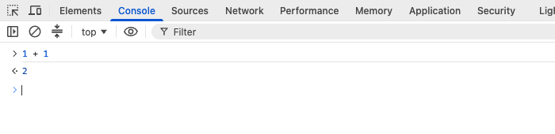

Before editing a course file, try JavaScript in your own browser. Its developer tools (DevTools) include a Console where you type a command and see its result. You do not need the course editor for these first three lessons.

## Make a practice tab

Open a new browser tab. Type `about:blank` in the **address bar** and press Enter. Keep the course in the other tab so you can read along. The practice tab should be an empty page, not your browser's new-tab dashboard.

Use only this blank tab for the commands ahead. Do not experiment on banking, email, sign-in, or other account pages. Console code runs in the selected page and can change it or access its data. Never paste code from strangers or instructions you do not understand. If your browser blocks pasting, leave that protection on and type these short commands yourself.

## Open the Console

With the blank tab active, use the shortcut for your browser:

| Browser | Windows / Linux | macOS |
| --- | --- | --- |
| Chrome or Edge | Ctrl + Shift + J | Command + Option + J |
| Firefox Web Console | Ctrl + Shift + K | Command + Option + K |

If a shortcut does not work, use the browser menu:

- Chrome: three-dot menu → More tools → Developer tools, then select **Console**.
- Edge: Settings and more (…) → More tools → Developer tools, then select **Console**.
- Firefox: Browser Tools → Web Developer Tools, then select **Console**. Depending on the menu layout, developer tools may be under More tools or the desktop Tools menu. Choose the page's **Web Console**, not Firefox's separate browser-wide Browser Console.

DevTools may open below the page, beside it, or in a separate window. You need the Console tab and its input prompt, not the address bar or the Console's Filter box.

## Type your first command

Click the input prompt, type `1 + 1`, and press Enter. Look for `2` below your command. Do not type the prompt's `>` symbol.

This is a real Chrome DevTools capture. Your colors and docking position may differ. The course also has a panel named Console; that panel shows course-program output and is not this browser command prompt.

Leave this practice tab open for the next lesson.
