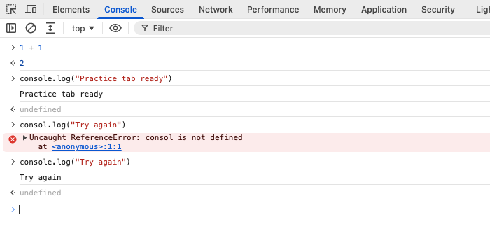

Return to the Console on your `about:blank` practice tab. The command `1 + 1` produced the value `2`. Now compare that result with a message printed by your code.

## A message and a return value

Type this command yourself, including the quotation marks, and press Enter:

```javascript
console.log("Practice tab ready")
```

You should see `Practice tab ready`, followed by `undefined`. The first line is the message that `console.log()` prints. The second is the command's return value: `console.log()` does not return a useful value, so the Console displays `undefined`. It is not an error.



The Console may also show a faint result preview while you type. Press Enter to execute the command and add it to the history.

## Make one harmless typo

On this blank page, type `consol.log("Try again")` and press Enter. The missing **e** in `console` causes a `ReferenceError`, usually saying `consol is not defined`. This command did not run successfully; it did not damage your practice page.

Read the error's first line. Then click the empty prompt, press **Up Arrow** to recall the command, fix `consol` to `console`, and press Enter again. The message `Try again` should appear. The old red error may remain in the history; it does not mean the corrected command failed.

## Enter, a new line, and a fresh page

In the normal single-line Console prompt, **Enter** runs a complete command. **Shift + Enter** inserts a new line without running it. Try typing `1 +`, pressing Shift + Enter, typing `1`, and then pressing Enter. The complete expression still gives `2`. Firefox also offers a separate multiline editor; stay in the normal prompt for this practice.

Up Arrow at an empty prompt retrieves earlier commands. You can edit one before running it again.

Use the browser's Reload button to start the blank page over (Ctrl + R on Windows/Linux, Command + R on macOS). Reload resets the page's temporary state. Console history may remain, especially with Preserve log/Persist Logs enabled. Clearing the Console display only removes messages; it does not undo changes to the page.
