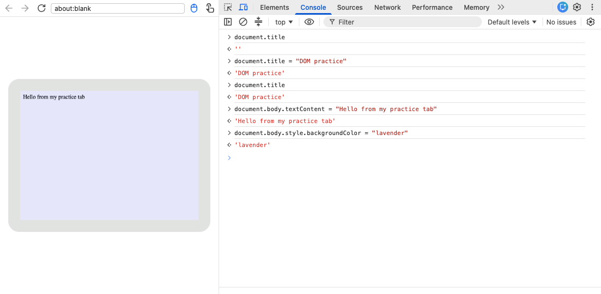

Keep the course open in one tab and use the Console attached to your `about:blank` practice tab. Reload the blank page before starting.

## Read a property

Type `document.title` and press Enter. On a fresh blank page the result is an empty string, usually displayed as `''` or `""`.

`document` refers to the page being inspected. The dot accesses a named **property**, such as `title`. Reading a property asks for its current value; assigning with `=` changes it.

Type these commands separately, pressing Enter after each:

```javascript
document.title = "DOM practice"
document.title
```

The tab title changes to **DOM practice**. The second command reads that title back. The assignment itself also evaluates to the string you assigned.

## Put text on the page

Type:

```javascript
document.body.textContent = "Hello from my practice tab"
```

`document.body` is the page's `<body>` element. Its `textContent` property holds its text. This assignment replaces everything inside the body with your message, which is why we are doing it only on an empty practice page.

Now type:

```javascript
document.body.style.backgroundColor = "lavender"
```

The page background turns pale purple. Here `style` gives access to inline styles, and `backgroundColor` is the JavaScript spelling of CSS `background-color`. You can change `"lavender"` to `"white"` and run the command again.



These are property assignments, not new functions you need to memorize. Later lessons explain how to find individual elements and change their text or style without replacing the whole body.

## Reset, then switch back to the course

Reload the practice tab. The text and background changes disappear; you changed the live document, not a saved HTML file.

The next lesson introduces the course editor. Its preview is a separate page inside an **iframe**. Browser DevTools normally starts in the outer course page, so `document` there is not the preview document.

If you later inspect a course preview with DevTools, use the Console's JavaScript context selector (often labeled **top** in Chrome/Edge) to choose the preview frame. If the frame is hard to find, right-click an element inside the preview and choose Inspect, then check the Console context selector. Read `document.title` and compare it with the lesson's HTML title before changing anything. Do not change the outer course page's body. The course's own Console panel and your browser's Console remain different tools.
