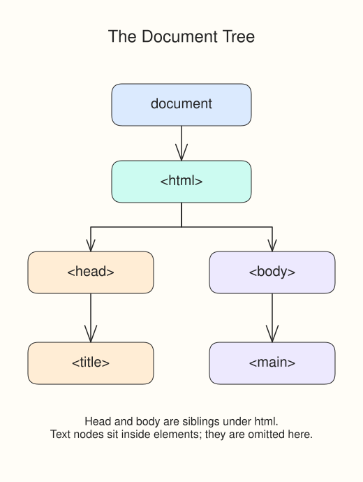

You changed a blank page through `document.body`. A page with more HTML uses the same entry point. The browser turns that HTML into the **Document Object Model (DOM)**, a tree of nodes that JavaScript can read and change.

The DOM is the browser's current tree, not a photograph of the original source. Parsing can repair malformed nesting, and JavaScript can add or remove nodes later. Element nodes represent tags; text and comments are nodes too. `window` provides the page's browser environment, while `window.document` is the document you are changing.

## Follow the nesting

Open `index.html` in the course editor. In this noticeboard, `<html>` contains `<head>` and `<body>`. The title is inside the head; `<main>` is inside the body. An element containing another node is its parent, and the contained node is its child.



`document.documentElement` refers to `<html>`. `document.body` refers to `<body>`. `document.title` reads the title text, rather than returning the `<title>` element itself.

## Read the supplied script

```javascript
const pageTitle = document.title;
document.body.dataset.pageTitle = pageTitle;
```

The first line stores the title in a variable. The second writes it onto the body. `dataset` gives JavaScript access to an element's custom `data-*` attributes: `dataset.pageTitle` corresponds to `data-page-title` in HTML. You will use data attributes more fully later; here we use one to make the document connection visible.

The supplied CSS watches for that attribute and displays a ready badge. You do not need to write that CSS.

## Run and make a small change

Press **Run**. The preview badge should read **Page connected**. Change only the `<title>` text from **Harbor notices** to **Harbor updates**, then Run again. The badge still appears. The script now stores the new title in the body's attribute, while the tree's shape stays the same. Restore the original title before moving on.

This is a worked example, not a graded exercise. The next lesson gives you a short script to write. The preview is its own document: its title does not rename the outer course tab.
