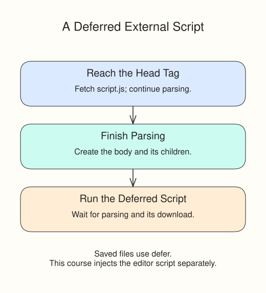

The earlier page placed its script at the end of the body, after the elements it needed. A script in the head needs a different arrangement: when the browser reaches that tag, it may not have created the body yet. At that point `document.body` is `null`, and assigning one of its properties fails.

## Let an external script wait

For an ordinary external script in a saved HTML page, add `defer`:

```html
<script src="script.js" defer></script>
```

The browser can fetch `script.js` while it continues parsing the HTML. It executes the deferred script after parsing finishes, when the body exists. This use of `defer` applies to an external script with `src`, not an inline script containing JavaScript text.



## Read the workshop example

Open `index.html` and find the script tag in the head. In `script.js`, this assignment marks the body ready:

```javascript
document.body.dataset.ready = "yes";
```

The supplied CSS watches `data-ready="yes"` and reveals **Workshop open**. Press Run to see it. Change `"yes"` to `"no"` and Run again: the ready message disappears. Restore `"yes"`.

## What this preview can show

The course preview injects the edited JavaScript separately, after the page content. It does not fetch your editor's `script.js` through the external tag. Removing `defer` here therefore does **not** demonstrate the real loading-order problem.

The tag above is the setup to use when you save `index.html`, `style.css`, and `script.js` together as actual files. In this course, inspect the tag to learn the loading setup and use Run to observe the DOM assignment. The next exercise checks those two things separately.
