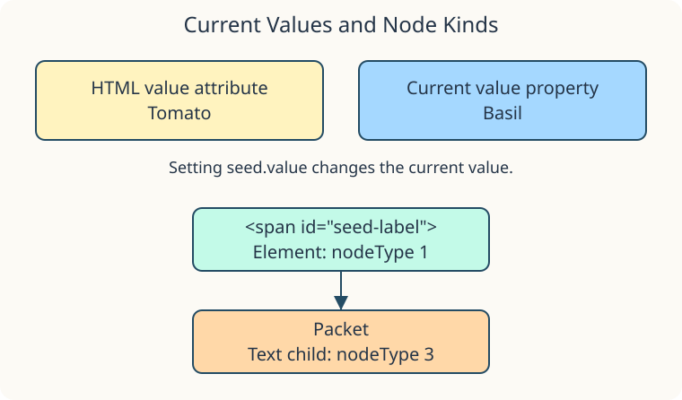

The seed-desk input starts with `value="Tomato"` in its HTML. This example changes what is currently in that input without changing the default written in the markup.

## Current value and HTML default

```javascript
const seed = document.getElementById("seed-name");
seed.value = "Basil";
```

The `value` property now holds `"Basil"`, which you see inside the input. `seed.getAttribute("value")` still reads `"Tomato"`. `getAttribute()` reads the named HTML attribute; pass its name as a string.

For this input, the property is the current value and the attribute supplies the default. Do not generalize that split to every property and attribute: many reflect each other.

## An element can contain a text node

Look at this exact markup in `index.html`:

```html
<span id="seed-label">Packet</span>
```

The span is an element node. The word `Packet` is inside a text node, its first child. `nodeType` identifies the kind of node: `1` for an element and `3` for text.

```javascript
const label = document.getElementById("seed-label");
const text = label.firstChild;
```

Here `label.nodeType` is `1`, and `text.nodeType` is `3`. `firstChild` means the first node, not necessarily the first element. Whitespace can be a text node too. Later lessons compare child nodes with element-only children.



## Run and compare

Run the supplied script. It copies the current property, the attribute, and the node types into separate lines. Expect **Basil**, **Tomato**, and **1 / 3**.

Change `seed.value` to `"Mint"` in `script.js` and Run. Only the current value should change. Restore `"Basil"` afterward.

You can also type in the input. Its current value changes, but the separate report does not refresh: this script reads the values once, when the page runs. Responding to later typing needs an event listener, which comes later in the course.
