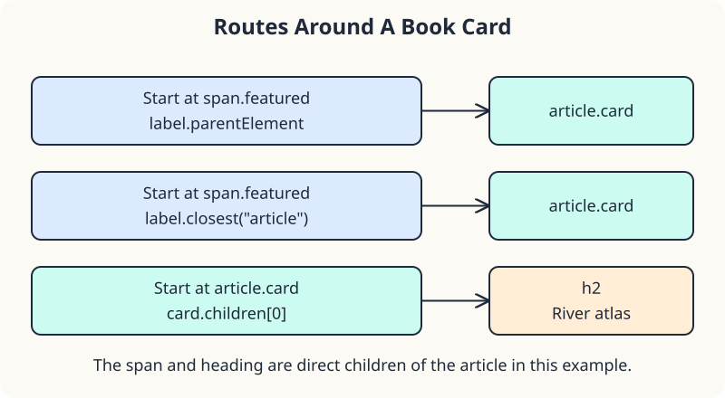

The Staff pick label belongs to a book card. Start at that label and use its position in the DOM to find the card and its heading.

`parentElement` gives the immediate parent element. `children` is a collection of direct element children; it skips text nodes such as whitespace between tags. Its first element is at index `0`. `closest("article")` checks the starting element, then each ancestor, stopping at the first match. It returns `null` if no element on that route matches.



```javascript
const label = document.querySelector(".featured");
const card = label.parentElement;
const firstChild = card.children[0];
const article = label.closest("article");
firstChild.textContent += " ★";
article.dataset.picked = "yes";
```

The last line is a small preview of data attributes: assigning `dataset.picked` writes `data-picked="yes"` on the article. The supplied CSS uses that attribute to draw a green border. You will study `dataset` in the next section; here it makes the selected ancestor visible.

Run and find the star and green border on River atlas. In this markup, both upward routes reach the article. If the span were inside a wrapper, `parentElement` would stop at the wrapper, but `closest("article")` would continue up to the card. That extra layer appears in the next exercise. These example elements exist; when a query or upward search can fail, check for `null` before using the result.
