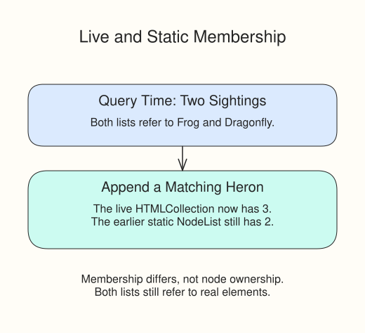

The pond survey starts with two sightings. The script takes two lists before adding a heron: one live collection and one static list.

`getElementsByClassName("sighting")` takes a class name without a dot and returns a live HTMLCollection. `querySelectorAll(".sighting")` takes a CSS selector and returns a static NodeList. The live collection updates when elements start or stop matching that class. The static list keeps the elements matched by that query.



The supplied code uses a few node-creation calls to make the difference visible. `document.createElement("li")` makes a detached element; `className` assigns its class string, and `textContent` sets its label. `appendChild(next)` places it in the list. You will practice node creation in its own section later.

```javascript
const live = document.getElementsByClassName("sighting");
const staticList = document.querySelectorAll(".sighting");
const original = Array.from(live);
original.forEach((entry) => {
  entry.textContent += " — checked";
});
```

`Array.from(live)` copies the current element references into an array. That fixes the membership for this loop and gives you `forEach`, which HTMLCollection does not provide. Both lists still refer to real nodes, not copies of their text.

Run the complete script. Frog and Dragonfly gain checked labels. Heron says new. The live count is 3 and the earlier static count is 2. Change the new element's `className` to `"other"` and Run again: the heron is still in the page, but it no longer matches the live collection, so that count stays 2. Restore `"sighting"` afterward.
