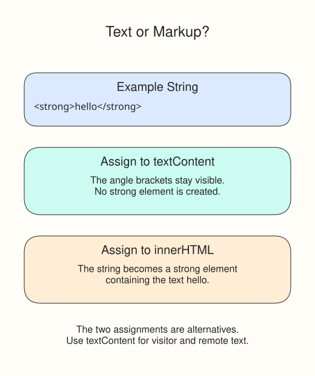

A visitor submits a note containing angle brackets. Show the note as written, without turning any of it into HTML.

`textContent` reads or writes an element's text. Assigning it replaces the element's children with plain text. `innerHTML` instead parses a string as markup, which can create elements and introduce unsafe content. Use `textContent` for visitor input and remote data. Reserve `innerHTML` for markup you control and trust.

```javascript
const boardNote = document.querySelector("#board-note");
const visitorNote = "I brought <seedlings> today";
boardNote.textContent = visitorNote;
```



Run the preview. It prints `<seedlings>` rather than creating an element with that name. Change the string in `script.js` to `"<strong>hello</strong>"` and Run: the tags should appear as text, not bold formatting. Restore the original note afterward.

Reading `textContent` gives the descendant text, including hidden descendants. It does not return HTML source. In the next exercise, you will use it for a museum caption.
