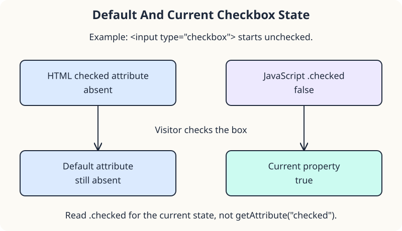

A garden-tour booking button becomes available when the visitor checks the agreement box. Read the checkbox's current state and use it to set the button's state.

## Attributes and current state

`disabled` and `checked` are boolean HTML attributes: their presence means true. Even `disabled="false"` disables a button. In JavaScript, `.disabled` and `.checked` are boolean properties, so assign `true` or `false`, not strings.

Changing `button.disabled` also changes the presence of its attribute. A checkbox is different: `.checked` tracks its current state, while the `checked` attribute describes its default state. Read `.checked` after someone interacts. `hasAttribute("disabled")` returns a boolean telling you whether the button has that attribute.



## A supplied connection to the checkbox

This demo introduces the small event connection needed for the next few lessons. `consent.addEventListener("change", updateBooking)` registers a **listener** on the checkbox. The string `"change"` names the event to wait for. `updateBooking` is the callback function the browser should call when that change happens.

Pass the function name without parentheses to register it for later. The separate `updateBooking()` call runs it now, once, to initialize the page. Unlike the earlier `forEach` callback, this callback waits for an interaction. The Events section will cover event objects and other listener patterns; you do not need those yet.

```javascript
function updateBooking() {
  reserve.disabled = !consent.checked;
  if (reserve.hasAttribute("disabled")) {
    status.textContent =
      "Agree to the tour instructions first.";
  } else {
    status.textContent = "Tour booking is ready.";
  }
}
consent.addEventListener("change", updateBooking);
updateBooking();
```

`!` reverses a boolean: checked means not disabled. Run, check the box, then uncheck it. The message and button should change together. A disabled native button cannot be activated by an ordinary user click.

For a direct attribute experiment, temporarily remove the final `updateBooking()` call and change the HTML to `disabled="false"`. Run: the button is still disabled because the attribute is present. Restore both edits afterward. The initial function call would otherwise set the button state before you could inspect the markup alone.
