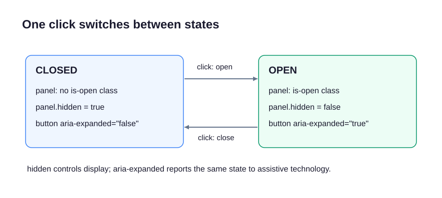

A Route details button opens and closes a panel. The panel's appearance, visibility, and accessible state must describe the same result.

`classList.toggle("is-open")` adds the class if absent and removes it if present. It returns `true` when the class is now present and `false` when absent. Save that result so the other updates can use it.



```javascript
const routeToggle =
  document.querySelector("#route-toggle");
const routeDetails =
  document.querySelector("#route-details");
routeToggle.addEventListener("click", () => {
  const isOpen = routeDetails.classList.toggle("is-open");
  routeDetails.hidden = !isOpen;
  routeToggle.setAttribute(
    "aria-expanded", String(isOpen)
  );
});
```

The listener is the same supplied pattern as before: the browser runs the arrow-function body once per click. Inside it, `!isOpen` gives the opposite boolean for `hidden`. `String(isOpen)` turns the boolean into the text `"true"` or `"false"` required by the attribute.

`hidden` controls whether the panel is displayed. `aria-expanded` tells assistive technology whether the controlled content is open; it does not show or hide anything by itself. The supplied `aria-controls` contains the panel's ID. The CSS gives `is-open` its appearance and does not override the browser's hidden behavior.

Run and activate the button twice, including from the keyboard if you prefer. First the details appear; the second activation closes them. The button stays available in both states. In the exercise, the callback shell is supplied and each of the three state updates has its own check.
