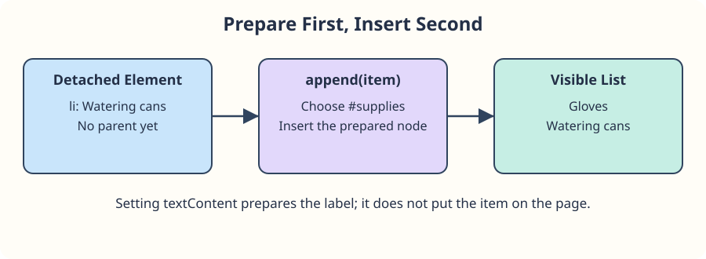

# Create an element, then show it

The garden supply board already lists Gloves. Add Watering cans without rewriting the list's HTML. You will use the selectors and safe text updates from the previous section.

`document.createElement("li")` creates an **element node**, not a text node on its own. At first it has no parent: it is detached, so the preview cannot show it. Set its `textContent` to give it a label, then call the list's `append` method to insert it as the last child.

```javascript
const item = document.createElement("li");
item.textContent = "Watering cans";
document.querySelector("#supplies").append(item);
```

`append` does not copy a node. If you append the same node elsewhere, it moves from its old parent to the new one.



## Try the preview

Run the finished example. Watering cans should follow Gloves. In `script.js`, temporarily comment out the last line and run again: creating and labeling the item is not enough to display it. Restore the line.

Next, try `"<b>Watering cans</b>"` as the label. The brackets should remain visible rather than becoming bold markup. Restore the original label before the reading-list exercise.
