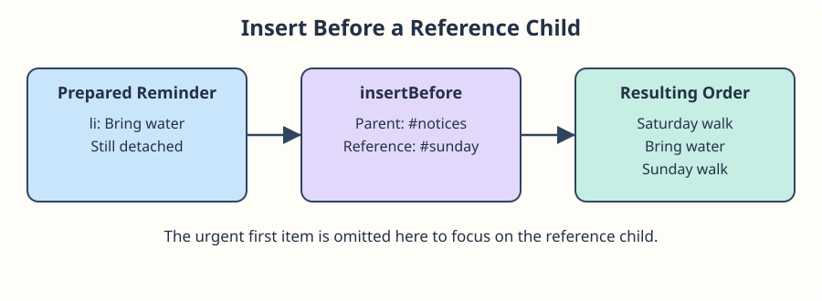

The trail board needs an urgent notice first and a reminder before Sunday's walk. You already know how to create a labeled element; now choose where it belongs.

`parent.prepend(node)` inserts at the beginning. `parent.insertBefore(node, referenceChild)` inserts directly before a particular child of that parent. Passing `null` instead of a reference child puts the new node at the end. A reference from a different parent causes an error.

```javascript
const board = document.querySelector("#notices");
const reminder = document.createElement("li");
reminder.textContent = "Bring water";
board.insertBefore(
  reminder, document.querySelector("#sunday")
);
```

Like `append`, these methods move an existing node rather than copying it. They also preserve the surrounding items.



## Try the preview

Run the finished script. Read the list from top to bottom: Bridge inspection today, Saturday walk, Bring water, Sunday walk.

Change the reminder's reference from `#sunday` to `#saturday`, then run again. Only the reminder's position should change. Restore the reference before ordering the workshop agenda.
