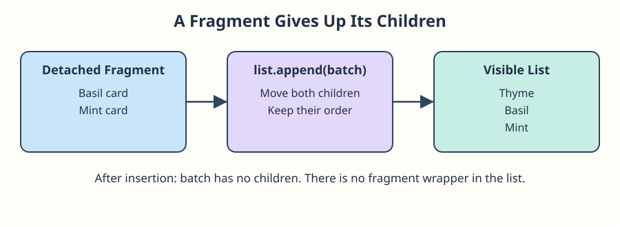

The seed swap has a Thyme card with a nested name and note. Add Basil and Mint cards without moving the sample out of the list.

`example.cloneNode(true)` creates a detached copy of the element and all its descendants. `cloneNode(false)` copies only the outer element, without its child elements or text. Query `.plant-name` **inside the copy** before changing its `textContent`; the name is a `strong` element in this example.

A deep clone also copies attributes. Repeated IDs would no longer identify one element, so this sample uses classes. If your source contains IDs, remove or change them on the copy and update any matching label references before insertion. Listeners registered with `addEventListener` are not copied; you will meet listeners in the next section.

`document.createDocumentFragment()` creates a detached holder for several nodes. Append the copies to it, then append the fragment to the real list. Its children move into the list in order. The fragment becomes empty; no wrapper element appears.

## Try the preview

Run: Thyme, Basil, and Mint should each have a Seed packet note. Change only `"Mint"` in the array to `"Sage"` and rerun; the other cards should stay unchanged. Restore Mint before making exhibit cards.
