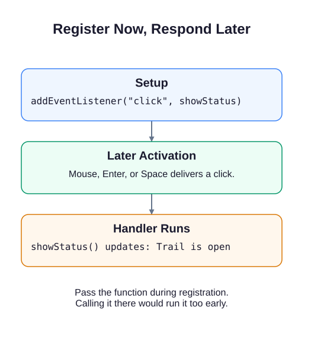

# Wait for a button activation

The trail status begins as Not checked. Unlike the node examples, this page should wait before changing anything: the visitor decides when to check.

`button.addEventListener("click", showStatus)` registers a function for a later event. Pass `showStatus`, without parentheses. Writing `showStatus()` would call it immediately and pass its return value instead.

```javascript
function showStatus() {
  document.querySelector("#status").textContent =
    "Trail is open";
}
document.querySelector("#check")
  .addEventListener("click", showStatus);
```

The browser calls this function when it delivers a click. A native `<button type="button">` already supports mouse, touch, Enter, and Space. Do not add a second keyboard handler to imitate its click behavior: one activation could then run your response twice. The supplied status region announces updated text without moving focus.



## Try the preview

Run and check that Not checked remains until activation. Click Check trail. Run again, focus the button with Tab, and try Enter or Space. Each route should show Trail is open.

Change the message in the handler and rerun to see that registration and response are separate. Restore it before the library exercise.
