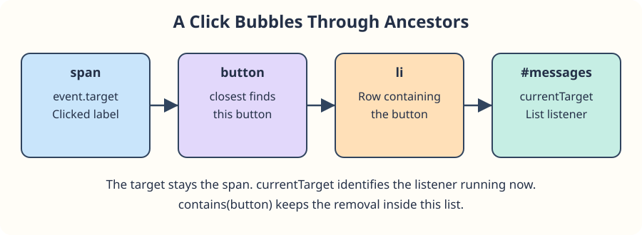

A message board can add rows after the page loads. One listener on the stable list can handle Remove buttons in both old and new rows. This is called **event delegation**.

The browser passes an event object to each listener. Naming the callback parameter `event` gives this function a local name for that argument; it is not a selector or an automatically shared variable. Read it during the callback, when `currentTarget` identifies the running listener.

A click normally bubbles: after the target's listeners, the browser visits listeners on its ancestors. Inside the list listener, `event.target` is the clicked element and `event.currentTarget` is the list running that listener. Clicking the nested label makes the `span` the target, not the button.

`element.closest(selector)` checks the element itself and then walks upward until it finds a match, or returns `null`. `list.contains(node)` checks whether a node belongs inside the list. Together they let the handler ignore plain text and buttons outside its own list.

```javascript
list.addEventListener("click", event => {
  const button =
    event.target.closest("button[data-remove]");
  if (!button || !event.currentTarget.contains(button))
    return;
  button.closest("li").remove();
});
```



The supplied Add message handler builds a row. `document.createTextNode("Fresh message ")` makes a plain text node to put before its button; assigning `button.type` sets the button type. `button.dataset.remove = ""` adds the `data-remove` marker used by the selector.

## Try the preview

Run, add a message, and remove the new row. Remove also works when you click the original nested label. Clicking ordinary row text should leave the row alone. No new Remove listener is needed when a row is added.
