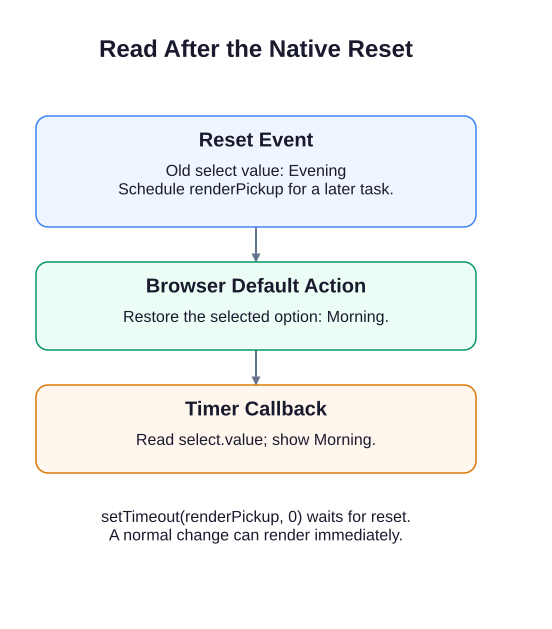

# Keep the display in sync after reset

The market pickup card shows Morning or Evening next to its select. Choosing a value and restoring the default are two different event paths to the same display function.

For a select, `change` reports a committed choice. Text inputs also have `change`, usually when an edited value is committed by leaving the field; use `input` when you need each edit instead. The select's `.value` gives the chosen option's value.

A form's `reset` event happens **before** its controls return to their defaults. The `selected` attribute in this markup defines Morning as the initial choice. Resetting a form does not automatically update a separate paragraph or fire `change` for each control.

```javascript
windowChoice.addEventListener("change", renderPickup);
pickupForm.addEventListener("reset", () => {
  setTimeout(renderPickup, 0);
});
```

`setTimeout(callback, 0)` schedules a later task; it does not run the callback immediately or guarantee an exact delay. Here that gives the browser time to finish its native reset before `renderPickup` reads the select. Pass the function reference without parentheses.



## Try the preview

Run, choose Evening, then activate Reset choice. Both the control and summary should return to Morning. Repeat with keyboard focus on the reset button. The display should not remain Evening.
