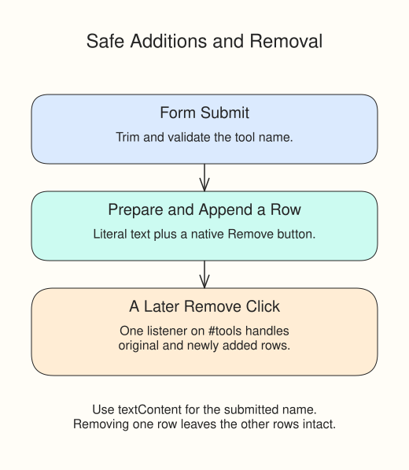

# Create and remove items with one delegated listener

A repair café tracks tools to bring. Visitors can add tools and remove either an original or newly added entry.

## Read the running example

This combines the earlier node-creation chapter with submit handling, accessible feedback, and event delegation. The parent list exists before any additions, so it is a dependable place for the click listener even when new buttons arrive later.

A form `submit` handler creates a new `<li>` with `document.createElement`. Put user-supplied text in `textContent`, never an HTML template, so characters such as `<` stay literal. One `click` listener on the stable parent list can handle Remove buttons on both original and future items: use `event.target.closest("button")`, confirm it belongs to this list, then remove its nearest list item.

Run the preview and locate the form, status paragraph, and tools list in `index.html`. The form handles additions; the list handles removals. Change the initial tool label, Run again, and remove that row to see where the removal message gets its name.

## Try it in the preview

Add “Soldering iron”, remove it, and remove a starter entry. Type `` and check that those characters display literally instead of turning into an image. Trace why the listener belongs to the list instead of each new button.

This is a finished example, not a graded task. The next exercise uses different data and leaves the behavior for you to write.

Duplicate tool names are allowed here: each submission is a separate row. After removal, the demo focuses the tool field so a keyboard user has a useful place to continue instead of focus disappearing with the deleted button.
