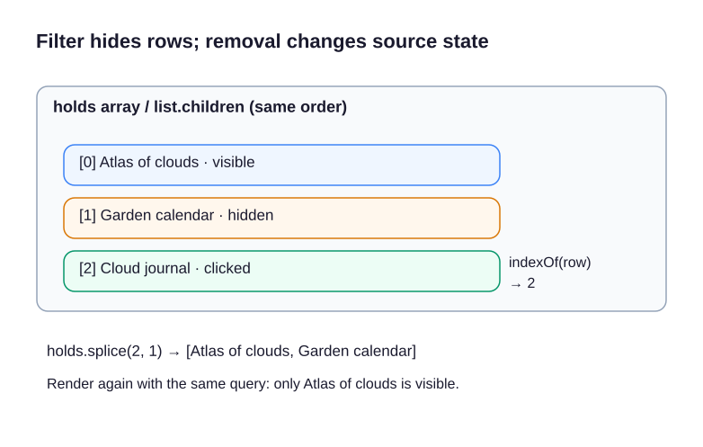

A library hold board shows a manageable way to filter and remove changing items. Use it as a model for finishing the workshop itinerary.

## Follow one update path

The query's `input` event calls `render()`, which tests each title with `toLowerCase().includes(...)` and sets each row's `hidden` property. It then writes the number of visible rows to a status region. Filtering does **not** delete the source array, so clearing the query restores all remaining entries.

Each row has a native `<button type="button">` with an action and its title in the accessible name. The click listener lives on the stable parent `<ul>`: `event.target.closest("button")` finds the clicked action, `list.contains` keeps unrelated buttons out, and `indexOf` finds the row's position. `splice` removes that entry from state before rerendering. Because real buttons handle Enter and Space, delegated clicks work for keyboard activation too.

Run the preview. Type “cloud”, remove one of the two matches, clear the query, and verify that the remaining rows and announced count agree. If clearing fails to restore a row, check whether it was hidden or removed from the source array. The following exercise brings both controls to the workshop planner.

`Array.from(list.children)` makes an array of the current rows. `indexOf(row)` finds a row’s position, and `holds.splice(index, 1)` removes one entry at that position. `splice` returns an array of the removed entries; `[0]` retrieves the one removed value when you need its name for feedback. Hidden rows still occupy their original positions. In the count expression, `.filter(item => !item.hidden)` creates an array containing only visible rows, and `.length` counts them. After removal, focus returns to the filter.

