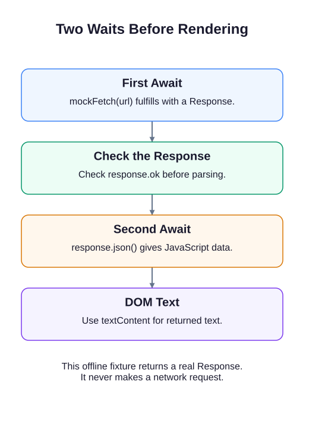

# Fetch JSON and render safe text

Click Load notice to put a service-style title on the noticeboard. The title contains `` characters on purpose: the page should print them, not create an image. This preview uses `mockFetch`, an explicitly named offline fixture. No request leaves the page.

## The async code you need here

A Promise represents a result that is not available yet. It starts pending, then either fulfills with a value or rejects with an error. Calling `fetch(url)` gives you a Promise, not the data itself.

Put `async` before a function so you can use `await` inside it. `await` pauses that function until a Promise settles; it does not freeze the page. If the Promise rejects, `await` throws an error. An async function also returns a Promise, so its caller can await completion.

A fulfilled fetch gives you a `Response` with a status and a body. `response.json()` reads that body and parses JSON text into a JavaScript value. It returns another Promise, so there are two waits:

```javascript
async function showNotice() {
  const response = await mockFetch("/api/notice");
  const notice = await response.json();
  document.querySelector("#notice").textContent =
    notice.title;
}
```

The mock constructs a real browser `Response` from a fixed object using `JSON.stringify`. You do not need to write a Promise constructor yet; the fixture supplies that machinery. In the exercise, you will await the response and use the resulting array.



Run, click Load notice, then change the fixture's title and Run again. The new title should appear only after clicking the button. Restore the fixture before moving on.

## The network version

On a deployed page, the corresponding call is `await fetch("/api/notice")` when that same-origin endpoint exists. Check `response.ok` before reading its body: an HTTP 404 or 503 still fulfills with a Response, while a network failure rejects. The next demo adds the error handler.

For an API on another origin, the server must grant your page access through CORS (Cross-Origin Resource Sharing). This browser rule limits which cross-origin responses JavaScript can read; it is not something a query string can bypass. The offline mock does not test connectivity or CORS.

## Learn more

MDN's [Using the Fetch API](https://developer.mozilla.org/en-US/docs/Web/API/Fetch_API/Using_Fetch) explains requests, response bodies, and errors.
