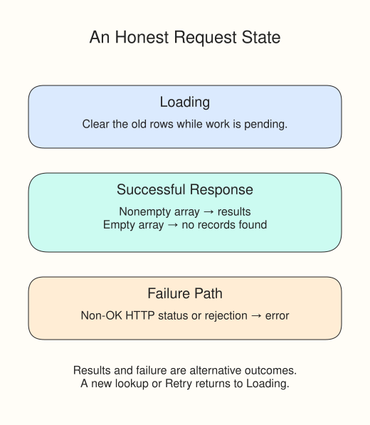

# Handle loading, empty, and failed responses

A library lookup needs more than a list. People should be able to tell whether it is still working, found nothing, or failed. Run this example and try each scenario in the selector. They are fixed offline cases, not the status of a real library.

## A delivered error is still a response

HTTP 503 means the server replied with a failure status. Fetch still fulfills with a Response. `response.ok` is true for success statuses from 200 through 299; check it before parsing JSON, because an error body may not have the shape you expect.

A network failure instead rejects the Promise. In an async function, that rejection throws at the `await`. A `try` block contains the work that may fail; `catch (error)` runs if a statement throws. You can use `throw new Error(...)` to send a non-OK HTTP response down that same error path.

```javascript
try {
  const response = await mockFetch("/api/record");
  if (!response.ok)
    throw new Error(`HTTP ${response.status}`);
  const data = await response.json();
  message.textContent =
    data.length ? "Ready." : "No records found.";
} catch (error) {
  message.textContent = `Could not load: ${error.message}`;
}
```

An empty array is a successful answer. It needs a different message from a failed request. The demo clears old rows as a new lookup starts, so an earlier result cannot look current while the next response is pending.



Choose Records and click Check records; you should get one title. Choose Empty and check again; the old title should disappear. HTTP error and Network failure should both report a problem. The mock normally settles too quickly for Loading to be visible; change its supplied delay from `150` to `800` to watch that state, then restore it.

The fixture uses `new URL(url, "https://preview.invalid")` only to parse a relative route. It never contacts that domain. A fixed base also works when the preview document's own address is `about:srcdoc`.
