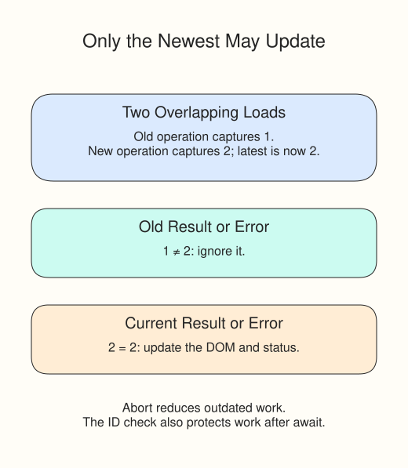

# Retry requests without stale results

Set the trail fixture's delay to `800` and Run. Search for `Cedar`, then quickly search for `River`. Only River lookout should be allowed to replace the list. Reset the delay after trying it.

The demo uses cancellation and a request number. Cancellation asks the earlier request to stop. The number protects later work too: if an old operation finishes anyway, it must not render or report an error over the new one.

```javascript
controller?.abort();
controller = new AbortController();
const request = ++latestRequest;
const response = await dashboardFetch(requestURL(), {
  signal: controller.signal
});
if (!response.ok)
  throw new Error(`HTTP ${response.status}`);
const data = await response.json();
if (request !== latestRequest) return;
```

`++latestRequest` increases the shared counter and gives this call its own number. After JSON parsing, equality means no newer load has started. The `catch` block checks the number too, then ignores `AbortError`. A current network or HTTP failure still shows the error message and Retry.



To try recovery, set `failNext: true` and Run again. Click Retry after the error: it should rerun the current query and hide the button while pending. All failures and delays are local fixture behavior, not measurements of a real service.

Your final exercise keeps the community-event data, helpers, and search from the previous stage. Add the guards without changing those completed parts.
