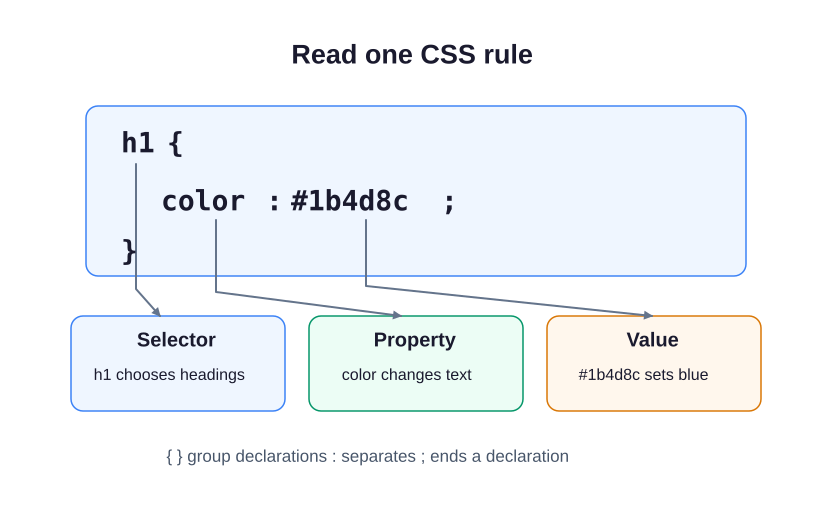

In HTML, you used color, font-size, and background-color to see how styles attach to a page. This museum card gives those rules a closer look. Its heading and paragraph are already supplied. HTML gives the words their structure. CSS (Cascading Style Sheets) controls how they look. Open `style.css` beside `index.html` to see the two files working together.

## Read one rule

```css
h1 {
  color: #1b4d8c;
}
```

The **selector**, `h1`, chooses every level-one heading. Inside the braces, the **property**, `color`, names what changes: the text color. The **value**, `#1b4d8c`, chooses a particular blue. A property and value form a declaration. A colon separates them, a semicolon ends the declaration, and braces group declarations for one selector.



CSS ignores text between `/*` and `*/`; those comments leave notes for the person editing a stylesheet. They do not change the preview.

The `body` rule uses `background-color` to paint behind the page content. Its supplied `font-family: system-ui, sans-serif` chooses the device's interface font, with a generic fallback. This is new typography vocabulary: the browser tries the named families from left to right. A generic fallback names a category rather than a particular installed font. Text inside the body can inherit the font: if it has no family of its own, it uses its parent’s family. Not every property inherits; padding and backgrounds, for example, do not. You will practice that distinction after specificity, then work on fonts in the next module.

## Change one thing

Press **Run**. You should see a blue heading on a pale page. Change only the heading's color value to `purple`, then Run again. The paragraph should keep its original color. Restore `#1b4d8c` afterward.

This demo has no tasks to submit. Next, write the background and heading rules yourself for another exhibit.
