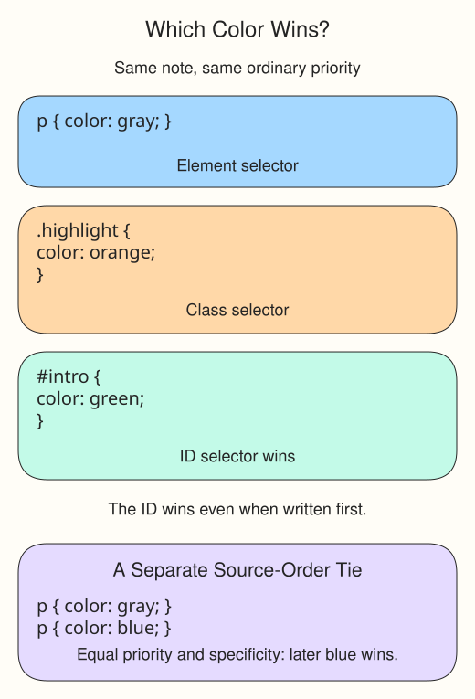

# When matching rules disagree

The museum note is a paragraph with both `class="highlight"` and `id="intro"`. Three selectors match it, but its text can only have one final color. The **cascade** is the browser's process for choosing that value.

```css
p { color: gray; }
.highlight { color: orange; }
#intro { color: green; }
```

These are ordinary rules in the same stylesheet, with no special priority settings. Here **specificity**, the weight of a selector, decides: an ID selector outranks a class selector, and a class selector outranks an element selector. The note is green because `#intro` wins. This does not mean the last line always wins.



If two otherwise equal rules use the same selector, the later declaration wins. For example, `p { color: gray; }` followed by `p { color: blue; }` gives paragraphs blue text unless a higher-priority rule overrides it. CSS has other priority mechanisms, but this exercise does not need them.

## Test the conflict

Run, then change `.highlight` to blue and Run again. The note stays green. Move the entire `#intro` rule above the others: it still wins. Restore the original order and orange class color. In the exercise, add rules one at a time to watch the winner change.
