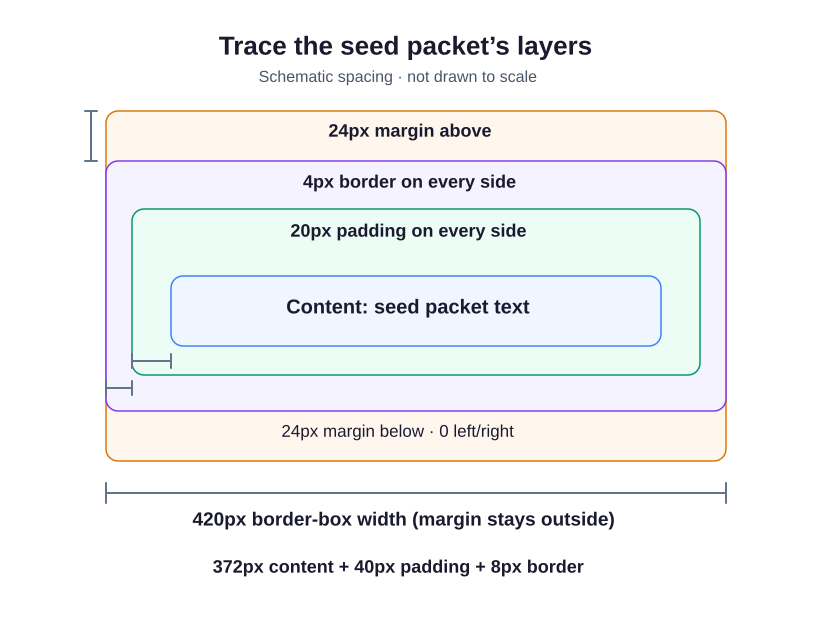

# See the layers of a seed packet

This module styles a Riverside Seed Swap card. Its text, inner spacing, outline, and outer spacing are different parts of the CSS **box model**.

The content is the text itself. `padding: 20px` adds space around it inside the border. `border: 4px solid #3c6e47` draws the green edge. `margin: 24px 0` sets 24px above and below the packet and zero at the left and right. Two margin values read “vertical, horizontal.” The same shorthand works for padding. With four values, read clockwise: top, right, bottom, left. One value applies to all four sides. An auto horizontal margin can share remaining space on either side of a width-limited block, which is how the supplied main element is centered.

The supplied `*` selector matches every element. Its `box-sizing: border-box` makes the declared width include padding and border. Without it, the usual `content-box` width covers only content, so padding and border add to that width. Margin stays outside either width.

The space in `.packet h1` and `.packet p` selects headings and paragraphs inside the packet. Those supplied rules remove the heading's top margin and paragraph's bottom margin so you can see the packet padding clearly.

Here `.packet` uses `width: 100%` to fill its parent. On a wide preview the parent is capped at 420px; the diagram uses that size. Narrower previews can make it smaller. Adjacent vertical margins can collapse together rather than add, so not every visible gap is a sum of margins.

## Move the inner edge

Run. Change the packet's padding to `36px`, then Run again. The text moves inward while the border-box width stays the same. Restore `20px` before the exercise.

## Learn more

MDN's [box-model guide](https://developer.mozilla.org/en-US/docs/Web/CSS/CSS_box_model/Introduction_to_the_CSS_box_model) describes these layers in more detail.
