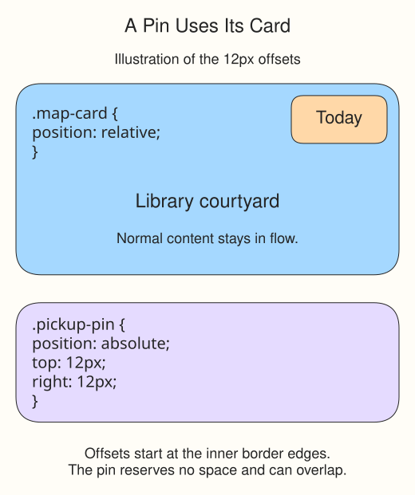

# Attach a pin to the map card

The “Today” pin belongs in the library card's upper-right corner. Normal flow lays out block and inline boxes in document order. The default position is static: offsets such as top do not move that box. With relative positioning, offsets shift the painted box while its original space stays reserved. Absolute positioning lets this small label leave that flow and sit over the card instead.

`.map-card { position: relative; }` keeps the card in its normal place while making it a reference for its absolutely positioned child. `.pickup-pin { position: absolute; }` removes the pin's reserved space. The text no longer moves down to make room for it.

`top: 12px` and `right: 12px` place the pin's edges 12px from the card's inner border edges. Here the card is the nearest positioned ancestor and supplies the pin's containing block. Without that reference, the pin could appear away from the card.

Absolute positioning can overlap text because it reserves no space. The card's padding keeps the pin clear of the main heading here. Use it for a small corner label, not as a replacement for page-layout tools.

## Move the pin

Run. Change `right` from `12px` to `48px`, then Run again: the pin moves left, farther from the right edge. Restore `12px`. The heading does not move with it.
