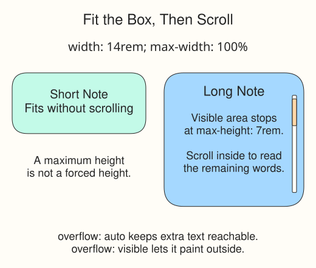

# Keep long notes inside their cards

One seed-swap note is much longer than the other. Instead of hiding its words or letting them spill onto the page, this demo limits the card's height and lets readers scroll inside it.

`width: 14rem` gives `.card` a preferred width. `max-width: 100%` caps it at the containing row's width. `max-height: 7rem` limits height but does not force a short note to fill that height. A `rem` is relative to the root font size; this page uses the browser's default.

`overflow: auto` allows scrolling when content does not fit. `visible`, the default, lets extra content paint outside the box. `hidden` clips it without offering a scrollbar, which is not what this reading task needs. The supplied Flexbox row arranges the cards; its rules come later. Its supplied alignment keeps the cards at their own heights while lining up their top edges.

## Scroll the long note

Run, place the pointer over the long card, and scroll to its final sentence. Your device may show a scrollbar only while scrolling. Set `overflow: visible` and Run to see the spill, then restore `auto`.

Narrow the preview. The `100%` maximum keeps cards within the row. The diagram illustrates these states rather than measuring your viewport.
