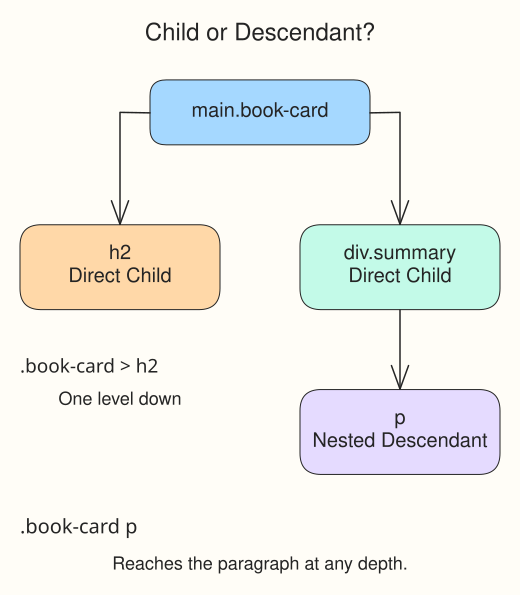

# Advanced selectors: book cart sign

The Moonlit Book Cart sign has a heading, a summary tucked inside a wrapper, and a sample link. You can target each part without giving every element a new class.

## Follow the HTML relationships

A **child** sits one level inside its parent. A **descendant** can be several levels down. In `index.html`, the heading is a child of `.book-card`; the paragraph is inside `.summary`, so it is a descendant of the card but not its child.

In `style.css`, `.book-card p` uses a space to reach paragraphs anywhere inside the card. `.book-card > h2` uses `>` to reach only direct child headings. The element on the right is the one being styled.

`a[target="_blank"]` uses square brackets to match an attribute value. It selects links whose `target` is `_blank`, not every link. The underline is a visual style; the HTML attribute controls where the link opens.

## Compare two selectors

Run the preview. The nested summary is pale blue, the title is larger, and the sample link is gold and underlined. In `style.css`, change `.book-card p` to `.book-card > p` and run again. The paragraph loses its pale blue because its immediate parent is `.summary`. Restore the space before the next exercise.
