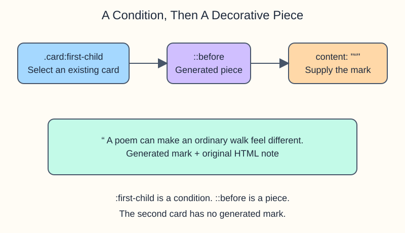

# Pseudo-elements: a note in the margin

The Moonlit Book Cart adds a decorative opening quote to a reader note. The note itself stays in `index.html`; the decoration comes from CSS.

A **pseudo-class** such as `:first-child` chooses an existing element by a condition. A **pseudo-element** such as `::before` lets you style a piece associated with that element. Notice the two colons.

Read `.card:first-child::before` in parts: find a card that is its parent's first element child, then style the generated piece before its content. `content: "“"` supplies the opening quote. Without `content`, this `::before` decoration is not generated. Its `color` styles the quote, not the whole card.

Keep essential words, labels, and instructions in HTML. Generated content is not a dependable substitute for accessible text, and a decorative quote should not carry information that the note needs to make sense.

Run the preview. Only the first card has a gold quote. In `style.css`, change `::before` to `::after` and run again: the mark moves after the note. Restore `::before`, then try changing its color. Restore `#fbbf24` before the exercise.
