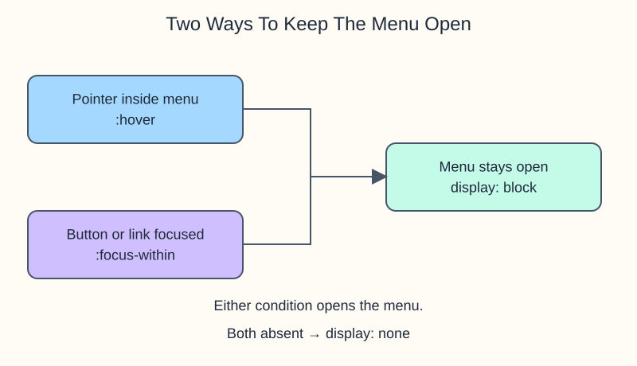

# Lantern Market dropdown demo

The market directory has two stall links. This finished CSS example hides them until a visitor points at Stalls or moves keyboard focus into the menu.

## Keep the links reachable

`.menu-item:hover .submenu` matches the submenu while the pointer is over its parent, including the open submenu itself. Targeting only the button's hover state would make it hard to move down to a link.

`:focus-within` is broader than `:focus`: it matches an element when that element **or any descendant** has focus. `.menu-item:focus-within .submenu` therefore keeps the links visible as you Tab from Stalls into the submenu. A comma between these two selectors lets them share `display: block`.

The starter layout uses `position: relative` on the parent and `position: absolute` on the submenu. `top: 100%` places the submenu below the parent's height; there is no gap for the pointer to cross. The links use `display: block` to stack. The supplied `:focus-visible` outline marks the control reached by keyboard.

## Try both routes

Run, hover over Stalls, and move down onto Coffee counter. The menu should stay open. Move to blank space to close it. Click a blank part of the preview, then press Tab to reach the brand link and Stalls. Tab through both stall links; Shift+Tab moves back. The menu closes after focus leaves it, provided the pointer is also outside.

Change `.submenu` background in `style.css`, run, and inspect the open menu. Restore `#f7c948` before continuing. This is practice with CSS states, not a complete production navigation widget: click-to-toggle, Escape-to-close, and reliable touch interaction need a fuller disclosure design. Do not treat this example as an accessibility-compliance claim.
