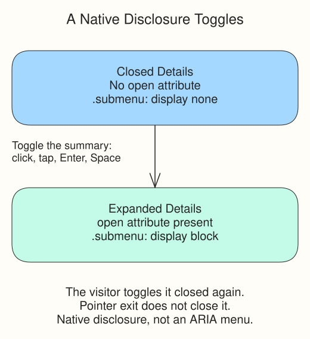

The directory has two stall links inside a native details element. Its summary, Stalls, is the control that opens and closes it. HTML already supplies the toggle behavior: click or tap the summary, or focus it and press Enter or Space. CSS only changes the presentation.

`.menu-item[open] .submenu` uses the attribute selector you learned earlier. The browser adds the boolean open attribute when details expands and removes it when it closes. There is no `open="false"` state: the attribute’s presence means open.

The base `.submenu` rule uses display: none; the more specific open-state rule changes it to block. The parent’s relative positioning anchors its absolute submenu, and top: 100% places it below the summary. A small z-index keeps the panel above the content that follows. This remains ordinary site navigation, not an ARIA menu with application-style arrow-key behavior.

## Try the toggle and focus path

Run, open Stalls, and Tab through the two links. Shift+Tab moves back. The summary and links have visible focus outlines. Return to Stalls and press Space to close it. Moving focus or the pointer away does not close an open native disclosure; the visitor controls its state. Escape-to-close is not supplied here.

Change the submenu background in style.css, Run, and inspect the open panel. Restore #f7c948. A hover-only reveal would not give touch and keyboard users the same toggle. Elsewhere, :focus-within is useful for highlighting a field group while any descendant has focus; it is not needed to replace details’ native open state.
