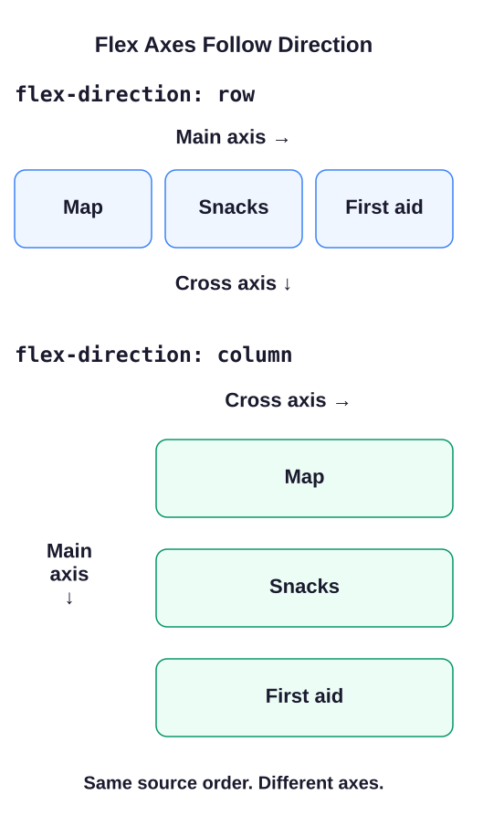

# Put the trail kit in a row

Without a layout rule, the three cards would be ordinary block elements stacked one below another. `display: flex` on `.kit-row` changes how that section arranges its direct children: Map, Snacks, and First aid become **flex items**. Put the layout rule on their parent, not on each card.

Flexbox works along two directions, called axes. The **main axis** follows `flex-direction`. With `row`, these English, left-to-right cards run across the page. With `column`, they run down the page. The **cross axis** is perpendicular to the main axis, so it changes too. “Main” does not always mean horizontal.

In `style.css`, `gap: 1rem` leaves space between the cards. A `rem` is based on the root element's font size; with the usual 16px default, this gap is 16px. Unlike padding, it does not create space inside a card.

Run Preview. Find `.kit-row`, change `flex-direction: row` to `column`, and run it again. The order stays Map, Snacks, First aid, but the main axis now points down. The cards stretch across the available width because that is the default cross-axis alignment. Restore `row` before the exercise.

## Learn more

[MDN's Flexbox guide](https://developer.mozilla.org/en-US/docs/Web/CSS/Guides/Flexible_box_layout) is a useful reference when you want to compare the alignment options.
