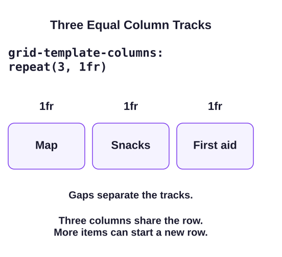

Flexbox arranged items along one main axis. Grid lets you define a shared set of columns and rows. It is useful when cards should line up with the cards above and below them.

`display: grid` on `.workshop-grid` makes its direct children grid items. A **track** is a column or a row, not an individual card. In `style.css`, `grid-template-columns: repeat(3, 1fr)` defines three column tracks. `repeat(3, ...)` repeats the size three times; it is a shorter way to write `1fr 1fr 1fr`.

The `fr` unit is a share of the available space. Here each column gets one equal share after the two gaps are allowed for. The supplied `overflow-wrap: anywhere` on the cards lets a long word break if it would otherwise force a track wider than its share. This matters for longer labels in the next exercise. A bare 1fr has an automatic minimum; long content can keep a track wider than an equal share. When the design needs tracks that may shrink below that content minimum, minmax(0, 1fr) gives an explicit zero lower bound. Text still needs a sensible wrapping rule, or it can paint outside its smaller track. The supplied `gap: 1rem` separates the tracks.

Run Preview, then change `repeat(3, 1fr)` to `repeat(2, 1fr)`. The browser places cards into cells in source order. With two columns, First aid moves into a new row that Grid creates automatically. A row does not need an explicit height to exist: its content gives it a height. Restore three columns before the exercise.

## Learn more

[MDN's Grid guide](https://developer.mozilla.org/en-US/docs/Web/CSS/Guides/Grid_layout) covers tracks and placement when you need a reference.
