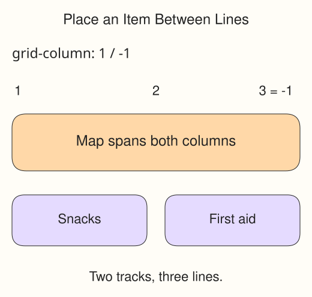

A grid's lines are the boundaries of its tracks. Two columns have three column lines: the start, the boundary between columns, and the end. Count from `1` at the start. Negative numbers count backward from the end of the explicitly defined grid, so `-1` means its last line.

In `style.css`, `.card:first-child` selects the first card. Its `grid-column: 1 / -1` declaration gives a start line and an end line separated by `/`. The card covers both columns and the gap between them. This rule belongs on the item; the parent still defines the tracks.

Run Preview. Temporarily remove `grid-column: 1 / -1`. The first card now occupies one cell and shares its row with the next card. Restore the declaration: the other two cards move into the next available cells below it. Their order in the HTML has not changed.
