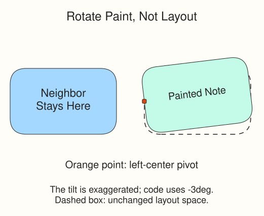

# Transforms
Give the pinned field note a slight tilt while leaving the neighboring fern survey in place. This is a fresh two-card example; it does not continue the color-system card.

`transform: rotate(-3deg)` turns `.tilted` by three degrees counterclockwise. `deg` means degrees; a positive value turns clockwise. The browser still reserves the card's original, unrotated space in the Flexbox row. Its painted edges can extend outside that space, so leave a gap around transformed items.

`transform-origin: left center` chooses the pivot: the left edge, halfway down. Without it, rotation uses the center of the card.

## Try the preview

In `style.css`, change `-3deg` to `3deg`, then Run Preview. The tilt reverses, but the other card stays put. Restore `-3deg`, briefly change the origin to `center`, and compare the pivot. Restore `left center` before the exercise.
