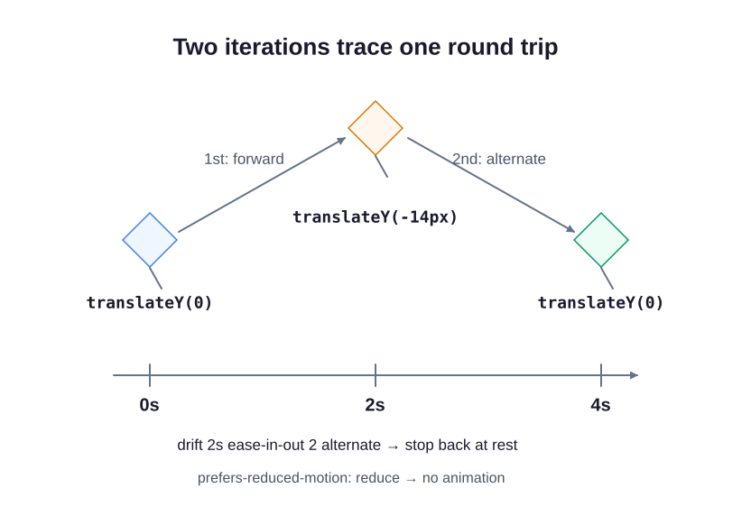

Make the festival kite drift upward and back. Unlike a transition, which waits for a property to change, a keyframe animation can begin as soon as the page loads. The button is only a styled placeholder; it does not reserve a pass.

## Read the motion rules

`@keyframes drift` names a sequence. `from` is its starting state and `to` is its ending state. Here `transform: translateY(0)` starts in the original position, while `translateY(-14px)` paints the kite 14 pixels higher. A negative Y value moves upward; this does not rearrange the surrounding layout.

The `.kite` rule attaches the sequence with `animation: drift 2s ease-in-out 2 alternate`:

- `drift` names the keyframes.
- `2s` gives each trip a duration of two seconds.
- `ease-in-out` slows the beginning and end of each trip.
- `2` runs two iterations: one upward trip and one returning trip.
- `alternate` reverses every other trip, bringing the kite back down.

The button uses `transition: transform 160ms ease`. This smooths a transform change over 160 milliseconds. Hovering or keyboard-focusing the button applies `translateY(-2px)`; leaving that state returns it to its original position.

The two trips finish after four seconds. For longer automatic motion alongside other content, give visitors a persistent pause/stop control; reduced-motion support alone is not that control. The infinite keyword exists, but an endless decorative loop is not the default here.

## Respect less-motion settings

`@media (prefers-reduced-motion: reduce)` applies when the visitor requests less motion. Unlike a width query, it checks a preference. Inside it, `animation: none` stops the kite, and `transition: none` removes the button's interpolation. We also reset the highlighted button's `transform` to `none`: disabling a transition alone would still leave an instant position change. The focus outline remains visible.

## Try the demo

Change the ending keyframe from `-14px` to `-5px` in `style.css`, Run Preview, and watch the shorter travel. Restore it. Hover the button, then use Tab to inspect its keyboard highlight. Enable reduced motion in your system or browser's rendering tools and rerun: the kite and button should stay still. Restore your preferred setting afterward.
