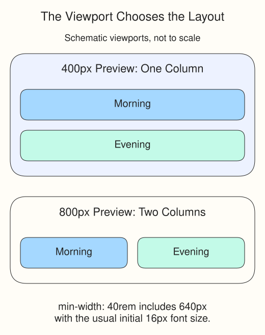

# Garden forecast
The two forecast cards need to be readable on a phone and sit side by side when there is room. The supplied HTML already includes a viewport tag in `<head>`; it lets a phone use its own width for the layout.

In `style.css`, `.forecast` is a grid with one `1fr` column by default. The `@media (min-width: 40rem)` rule overrides its columns only when the viewport is at least 40rem wide. `repeat(2, 1fr)` makes two equal columns. The cards themselves do not need to change.

## Know which width you are changing

The viewport is the area where this document renders. Inside this course it is the preview iframe, not the whole browser window and not the card's width. Resize the preview pane if its divider allows it. Otherwise open the example in a separate browser page and resize that page; merely zooming the lesson text is not the same test.

`rem` is a length based on the root font size for ordinary properties. In media queries it uses the browser's initial font size, commonly 16px. With that default, 40rem is 640px. A `min-width` query includes its boundary, so this demo changes at 640px, not only above it. The nested `.forecast` rule comes later and overrides the earlier columns while the query matches.

## Try the demo

Preview the page at a narrow and a wide width. Below 40rem the cards stack; at 40rem and above they share a row. Temporarily change `40rem` to `50rem`, resize again, and notice where the layout switches. Restore `40rem` before moving on.

**Checkpoint:** You can find both `.forecast` rules and explain why the wider one wins only at its breakpoint. Next you will adapt a different forecast using the same pattern.

## Learn more

For more examples of breakpoints and fluid layouts, see [MDN's responsive design guide](https://developer.mozilla.org/en-US/docs/Learn_web_development/Core/CSS_layout/Responsive_Design).
