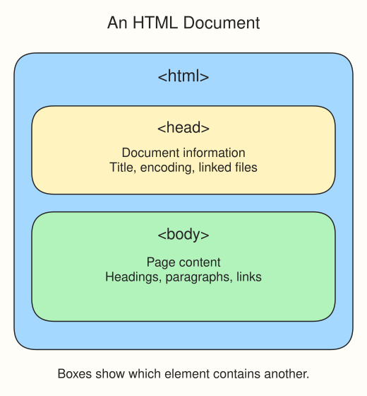

# What is HTML?

Welcome to the world of web development. This course is about HTML coding. HTML provides the skeleton, the content of the web pages. You can see a very simple HTML code in the code editor. You may not understand it all at the moment, but do not worry, you will understand that fully by the end of the course.

HTML stands for **HyperText Markup Language**. It labels the parts of a page as a heading, a paragraph, a hyperlink, an image, etc. The browser reads those labels and displays the content.

Our first examples come from the survey vessel **Meridian**. You will make short signal pages before trying separate community projects later in the course. You do not need to carry code between lessons.

## Read a tag pair

Below is a single line from the code.

```html
<p>A transmission has arrived from the survey zone.</p>
```

Here, `<p>` is the opening tag. `</p>` is the closing tag; notice the slash. The tags and the text between them make one **element**. Type the angle brackets as shown, and change the words between them when you want different content.

The completed `index.html` in the editor uses `<h1>` for its main heading and two `<p>` elements for separate paragraphs. Tags tell the browser what each piece is, not just how large to draw it. 

## Run and compare

For this lesson, simply Press **Run** button. Find the prominent “Meridian Signal” heading and the two paragraphs below it. In the editor, change only the heading's words, run again, then restore them. This lesson doesn't have any specific tests.

The surrounding document has two parts:



Next, write a new arrival signal using the same heading-and-paragraph pattern.
