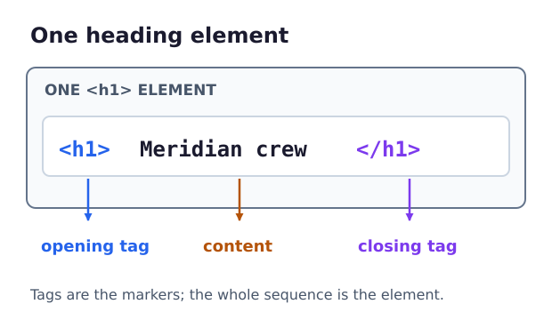

You have written content inside a body. This finished crew profile shows what surrounds that content. Run `index.html`, then compare the preview with the code. Here is the full document, one part at a time.

```html
<!DOCTYPE html>
<html lang="en">
  <head>
    <meta charset="UTF-8">
    <title>Meridian Crew Profile</title>
  </head>
  <body>
    <!-- Profile heading for the survey team -->
    <h1>Meridian crew</h1>
    <p>The crew is surveying the north tower.</p>
  </body>
</html>
```

## Doctype Declaration

`<!DOCTYPE html>` asks the browser to use modern HTML rendering. This doctype declaration belongs before the `<html>` element, which contains the document. Its `lang="en"` is an **attribute**: extra information written in an opening tag as a name and quoted value. Here it declares English as the main language.

`<html>` is the opening tag and `</html>` is its closing tag. The element between them can contain other elements, forming a nested structure.



The `<head>` holds page information rather than visible paragraphs. `<meta charset="UTF-8">` declares the document's text encoding so characters display correctly. `<title>` names the document; it appears in a normal browser tab, though this embedded preview has no separate tab title.

The `<body>` holds the visible page content. Indenting child elements makes the nesting easier to read; indentation is not a layout tool. Spaces between words can affect text, but adding indentation before a tag will not move that element across the page.

## Keep pairs inside their parent

When writing your first pages, it's easy to forget the closing tag. An inner element must close before its outer element closes as you can see below.

```html
<body>
  <h1>Meridian crew</h1>
</body>
```

In this example, we have `<h1>` tag closed inside `body` element before closing the `body` tag which is parent to `h1` element.

Write attributes in the opening tag, separated by spaces, for example `<html lang="en">`. The closing tag is just `</html>`, without attributes. Quote attribute values so a value containing spaces stays together. Ordinary source line breaks collapse into text spacing; they do not create extra paragraphs.

Some elements have no content or closing tag. These are **void elements**, including the `<meta>` above and the images and inputs you will meet later. Both `<meta charset="UTF-8">` and `<meta charset="UTF-8" />` occur in HTML; the trailing slash is optional and does not create a closing tag.

## A note that stays in the source

An HTML comment begins with `<!--` and ends with `-->`. The browser does not display it, but anyone who can read the page source can see it. Use comments to explain the code, not to store private information.

In the editor, change the comment's words and run again. The preview should not change. Restore it, then change the `<h1>` text and run again. Restore the heading when finished. This lesson doesn't have any tests.

Next, let's apply the same kind of document structure to one crew member's profile.
