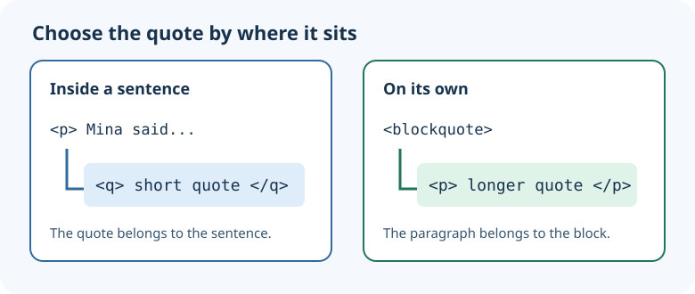

The repair café keeps a short note from a volunteer alongside its sign-in instructions. Run the finished page in `index.html` and notice that the quotation is set apart while the command stays legible as code.

## One kind of text at a time

`<q>` marks a short quotation *inside* a sentence. `<blockquote>` holds a longer quotation that stands on its own; put a paragraph inside it. Neither tag is a substitute for a paragraph chosen just for its spacing.

```html
<p>Mina said, <q>Keep the old parts in a labeled box.</q></p>
<blockquote>
  <p>Every repaired lamp should be tested before it goes home.</p>
</blockquote>
```

`<abbr title="Frequently asked questions">FAQ</abbr>` gives the abbreviation its full form in the source. Do not rely on a hover tooltip alone to teach an unfamiliar term: write out the expansion in nearby prose when the reader needs it. `<code>` identifies a piece of computer code, while `<pre>` preserves whitespace in a multi-line sample.



## Check the preview

Find the quotation inside Mina's sentence, then the separate volunteer note. In the source, find the full form of `FAQ` and the command inside `<code>`. Change the command's words and Run again; the code style remains, but the text changes. Restore the command before moving on. The next lesson starts with a smaller page so you can build these relationships yourself.
