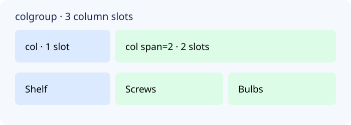

The repair café's stock table has three columns. Run `index.html` and read each shelf row. Unlike a row, a column is spread across several rows. `<colgroup>` describes column slots before the row groups; each `<col>` claims one slot unless `span` says otherwise.

```html
<caption>Spare parts by shelf</caption>
<colgroup><col><col span="2"></colgroup>
<thead>...</thead>
```



The first `<col>` covers Shelf; the next covers two columns. Count slots, not row cells. The preview looks much the same because column grouping alone adds no visible styling. It also does **not** label cells for screen readers: keep `<th scope="col">` and `<th scope="row">` for header relationships. Column groups become useful when styling or annotating whole columns later in CSS.

## Check the preview

Find the three column headers and two rows. Temporarily change `span="2"` to `span="1"`; the rows still display, but the group now describes only two of three slots. Restore it, then build a different table in the next lesson.
