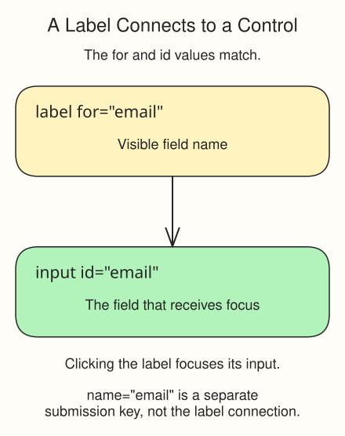

# Build a Night-Shift Check-In

Build a night-shift check-in for a different crew, using the relay intake as a reference. It needs an operator name, backup email, and access phrase.

Edit `index.html` below the supplied heading. Run to inspect each addition and Submit to check it. Use made-up values only; `/night-shift` is an illustrative route with no receiving service. Do not submit the form itself in the preview.

## Your Tasks

1. Add one `<form>` for the check-in controls.
2. Inside it, add a text input with `name="operator-name"` for the operator.
3. Add an email input with `name="backup-email"` for the backup address.
4. Add a password input with `name="access-phrase"` for the practice access phrase.
5. Add a submit button with visible action text inside the form.
6. Connect a visible Operator name label to the text input using matching `for` and a unique `id`.
7. Connect a visible Backup email label to the email input in the same way.
8. Connect a visible Access phrase label to the password input in the same way.

## Check your page

Run the page and click each label. It should focus the corresponding field; the submit button should be visible at the end of the form.

The crew has a clear route into the Meridian Relay, and every field has a human-readable label.
