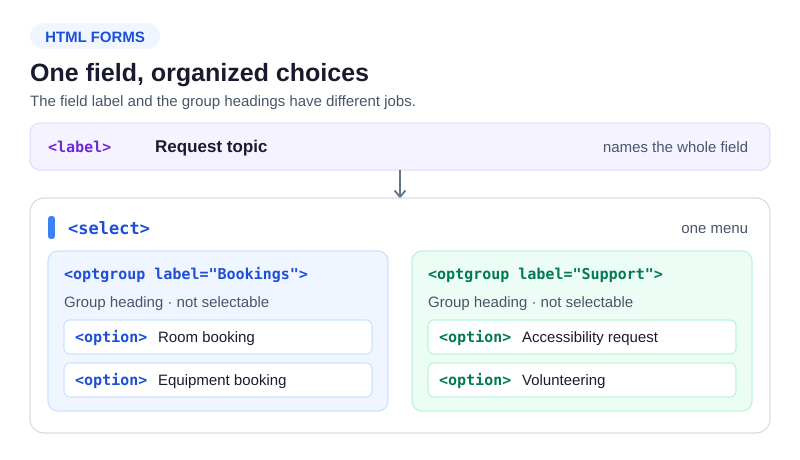

The community hall has more request topics than a flat menu can comfortably show. Run `index.html` and open the Topic menu. Its options are split into Bookings and Support; those are *group labels*, not selectable answers.

```html
<label for="topic">Request topic</label>
<select id="topic" name="topic">
  <optgroup label="Bookings">
    <option value="room">Room booking</option>
  </optgroup>
</select>
```



`<optgroup label="...">` groups related `<option>` children. Keep the `<label>` for the entire select: optgroup labels do not replace it. Each selectable option needs a useful value. The placeholder option above the groups is optional; it is not a group heading. Screen-reader announcements and menu styling vary by browser, so use visible, descriptive wording as well as the markup.

## Check the preview

Open the menu and find both group names and their choices. Temporarily change the Support label and Run; the choices stay the same. Restore it before the following practice.
