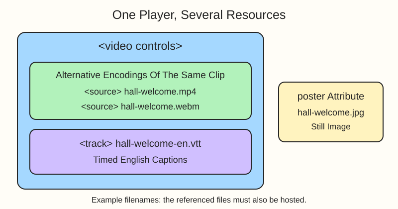

The hall's contact form collects messages. This section changes direction: you will describe media that visitors can watch or listen to. Start with a welcome video for Riverlight Community Hall.

## Read the player markup

A `<video>` element creates the player. `controls` asks the browser to supply play, pause, volume, and seeking controls. Nested `<source>` elements offer different encodings of the same clip; `type` identifies each format. The browser chooses a supported source.

Here is a library-tour example. Its filenames illustrate files that would need to be hosted beside the page:

```html
<video controls width="480" height="270" poster="library-tour.jpg">
  <source src="library-tour.mp4" type="video/mp4">
  <source src="library-tour.webm" type="video/webm">
  <track kind="captions" src="library-tour-en.vtt" srclang="en" label="English">
  Your browser does not support the video element.
</video>
```

`poster` names the still image displayed before playback. A captions `<track>` links to a WebVTT (`.vtt`) file containing timed text for speech and relevant sounds. `srclang` identifies its language; `label` names it in the player's menu. Adding the tag alone does not create captions: the file must exist and match the recording.



The fallback sentence inside `<video>` is for browsers that do not support the element. It is not an error message for missing or unplayable files. Put any always-available transcript or download link outside the player.

## Practice the structure

Edit `index.html`. The starter supplies a heading, not a finished player. The hall filenames below are placeholders, so this exercise checks HTML relationships rather than playback. No video, poster, or captions files are supplied.

Put the file addresses on the nested `<source>` elements, not on `<video>` itself. A `src` on the player would take precedence over its source list.

## Your Tasks

1. Below the heading, add one `<video>` with `controls`.
2. Inside that video, add a `<source>` for `hall-welcome.mp4` with `type="video/mp4"`.
3. Add a second source inside the same video for `hall-welcome.webm` with `type="video/webm"`.
4. Give the video `poster="hall-welcome.jpg"`.
5. Inside the video, add a captions track for `hall-welcome-en.vtt` with `kind="captions"`, `srclang="en"`, and `label="English"`.

Run to inspect the player area, then Submit to check your markup. An empty player or failed media request is expected with these placeholder files. A passing check does not prove that a video plays or its captions are accurate.

## Playback choices

`preload="metadata"` hints that the browser should fetch basic media details. `loop` repeats the clip; `muted` starts it without sound. Leave `autoplay` off for this welcome video so visitors choose when to start. Browsers often block audible autoplay, and even muted autoplay is not guaranteed.

After publishing real files, test playback and the captions menu separately. Check that the captions convey the spoken words and important sounds, not just that a menu item appears.
