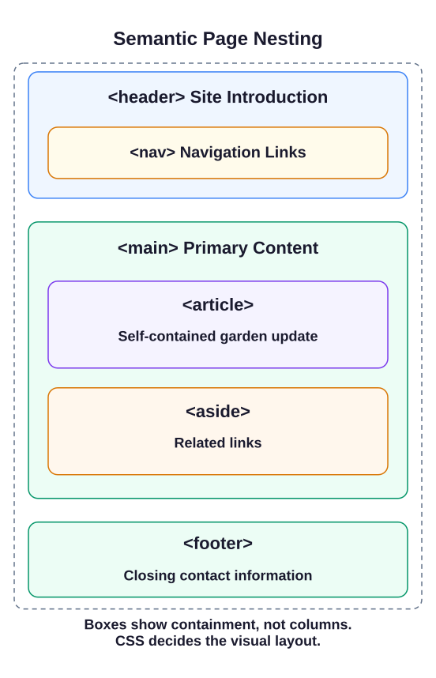

Media adds content to a page; semantic HTML explains how the page is organized. Build a harvest update for Riverstone Community Garden, a new setting separate from the hall examples.

## Choose an element for its job

A `<div>` groups content without saying what it means. More specific elements describe the job of a region:

| Element | Job on this page |
| --- | --- |
| `<header>` | Introduces the site with its name |
| `<nav>` | Groups navigation links |
| `<main>` | Contains the page's primary content |
| `<article>` | Holds an update that makes sense on its own |
| `<aside>` | Holds related, secondary information |
| `<footer>` | Provides closing contact information |

Use one visible `<main>` for this page. A `<section>` groups a topic, usually under a heading; use `<article>` when that topic is also a self-contained item, such as a news update. These elements describe structure, not columns or colors. CSS would control the layout.

Main and navigation create landmarks that assistive technology can use. Not every semantic element is a landmark: an article has article semantics, and a header or footer inside an article does not become the page-wide banner or content-information landmark.



## Read a different example

The library notice below uses the structure you need, with different content:

```html
<header>
  <h1>Willow Lane Library</h1>
  <nav>
    <a href="/catalog">Catalog</a>
    <a href="/hours">Hours</a>
  </nav>
</header>
<main>
  <article>
    <h2>Saturday story hour</h2>
    <p>Story hour starts at ten in the reading room.</p>
    <time datetime="2026-08-15">August 15, 2026</time>
  </article>
  <aside>
    <h2>Library links</h2>
    <a href="/membership">Become a member</a>
  </aside>
</main>
<footer>
  <p>Ask at the library desk for more information.</p>
</footer>
```

`<time>` pairs a readable date with a machine-readable `datetime`. Here the sample date is August 15, 2026 in `YYYY-MM-DD` form, not a claim about today. The visible words and the attribute should describe the same date. The library and garden link paths illustrate a larger site; those destination pages are not supplied here, so inspect the destinations without navigating away.

## Your Tasks

1. Add one page-level `<header>` containing an `<h1>` with the garden's name.
2. Inside that header, add a `<nav>` with at least two labeled links and nonempty destinations.
3. Add one page-level `<main>` after the header.
4. Inside `<main>`, add an `<article>` with an `<h2>` for a garden update and a paragraph describing it.
5. Inside the article, add `<time datetime="2026-08-15">August 15, 2026</time>` for the update date.
6. Inside `<main>`, after the article, add one `<aside>` with an `<h2>` and a labeled related link.
7. After `<main>`, add one page-level `<footer>` with closing contact or copyright text.

Edit `index.html`, Run, then Submit. The starter supplies only the document shell. Build one region at a time; the checks follow the task order. In the preview, headings should identify each region's content even though the browser stacks the regions vertically. The diagram shows nesting, not a promised visual layout.
