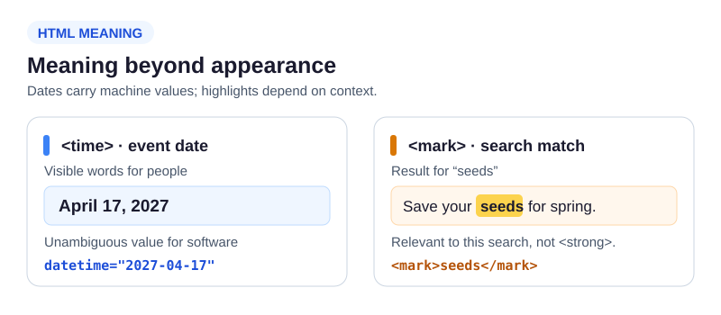

The garden page used `<time>` for an event date. Here a seed-swap notice puts it beside a search result: one piece is a date that software can read, the other is a phrase highlighted because it matches a visitor's search.

Run the completed `index.html` and compare the source with the preview. The date's visible words are for people; `datetime` gives software an unambiguous value. `<mark>` indicates a highlight relevant *in this context*, not stronger importance. Use `<strong>` when the words themselves are important, not merely highlighted as a match.

```html
<p>Next swap: <time datetime="2027-04-17">April 17, 2027</time></p>
<p>Result for “seeds”: Save your <mark>seeds</mark> for spring.</p>
```



Change only the visible date words in the editor and Run: the page changes, but the `datetime` value does not. Restore the words. Then change the text inside `<mark>` and notice which word is highlighted. Restore it before the next lesson, where you will write both relationships on a different page.
