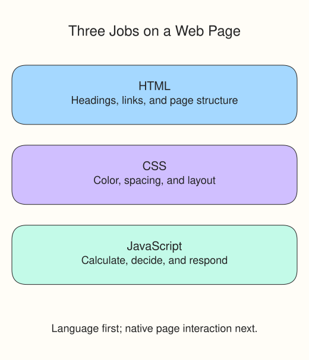
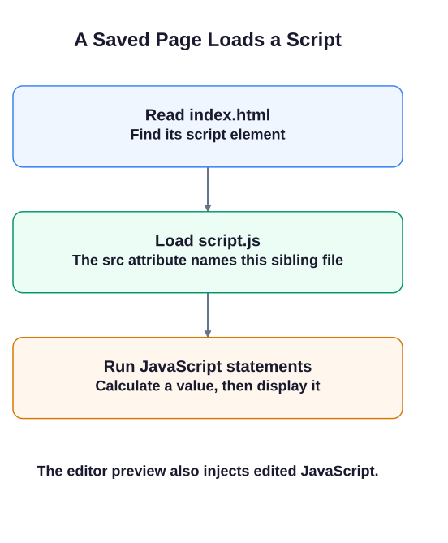

# What is JavaScript?


The Starline Awards scoreboard starts as a static page. In this one bridge lesson, connect `index.html` to `script.js` and show a calculated result in the page. The remaining lessons in these sections use only `script.js` and the Console.

Run the starter: the preview paragraph is blank, and the Console shows the two unfinished values. You will fill those values in one at a time before displaying their combined message. Leave the supplied HTML in place.

A statement is one instruction. JavaScript runs these statements from top to bottom. In `const notice = "Exhibit open";`, `const` creates a name, `=` assigns its first value, and the quotes mark text. The semicolon ends the statement. Change the value on the right of `=`, not the name on the left.

The page-output line uses `document.getElementById("output")` to find the supplied paragraph, then assigns its `textContent`. For step 3, replace the empty string with a backtick string containing `${introMessage} | ${introNumber}`. You do not need to write any other page code.

In a saved web page, the script tag loads the file. This learning preview also injects your JavaScript so it can run edited code; removing the tag may not stop the preview, but the connection is still required for a standalone page.

JavaScript runs in the browser and powers the interactive parts of the web. This first coding lesson keeps the idea simple: store a message, calculate a number, and show both on the page.

## HTML, CSS, and JavaScript have different jobs



- **HTML** gives the page its structure and content.
- **CSS** controls the visual presentation.
- **JavaScript** calculates, decides, and responds to input. This first lesson writes a result into the page only so you can see how the two files connect.

## Include JavaScript from HTML



`index.html` contains the page shell and includes this line near the end of `<body>`:

```html
<script src="script.js"></script>
```

That `src` value is the filename. When you save these two files in the same folder, the browser reads `index.html`, reaches the script tag, and loads `script.js`.

The built-in editor combines the tabs into a preview when you press Run; it does not publish a separate `script.js` at the lesson's web address. Both tabs are visible here to show the connection. From the next lesson onward, you will work in `script.js` and the Console only.

## Example

`const` gives a value a name. In the last line, `${...}` inserts a value into the backtick-delimited message. The Console displays the result; the starter's `document.getElementById("output").textContent` displays it on the page instead. You will study these tools in more detail later.

```javascript
const notice = "Exhibit open";
const visitors = 4 * 6 - 1;
console.log(`${notice}: ${visitors}`);
```

The final `window.introCheckpoint` line is supplied so Submit can inspect the two values independently. Leave it in place, along with the checkpoint logs. Edit `script.js`, use Run to see the page and Console, then Submit to check your work.

## Your Tasks

1. Set `introMessage` to `"JavaScript rocks!"`; the provided probe will log `message: JavaScript rocks!`.
2. Calculate `introNumber` as `(5 * 3) + 2`; the provided probe will log `number: 17`.
3. Show `JavaScript rocks! | 17` in `#output` using both values.
