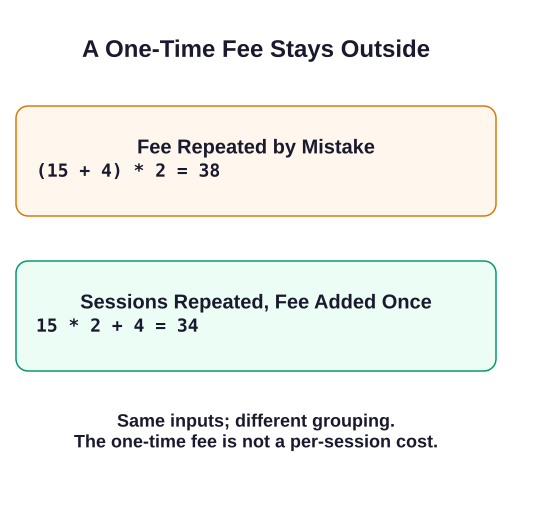

# Trace a Faulty Calculation

A rehearsal invoice charges for two sessions and one fixed setup fee. The wrong expression multiplies the fee too. Log the parts so you can see where the discrepancy starts.



```javascript run
const sessionCost = 15;
const setupFee = 4;
const sessions = 2;
const faultyTotal = (sessionCost + setupFee) * sessions;
console.log("sessions:", sessionCost * sessions);
console.log("setup:", setupFee);
console.log("faulty:", faultyTotal);
```

Parentheses tell JavaScript to evaluate the enclosed addition first. The faulty expression adds the setup fee to each session, then charges that combined amount twice. The sessions cost 30, so one setup fee of 4 should produce 34, not 38.

In the corrected example, multiplication happens before addition. Run the second block and compare its total with the first; these are two separate examples, so each declares its own inputs:

```javascript run
const sessionCost = 15;
const setupFee = 4;
const sessions = 2;
const correctedTotal = sessionCost * sessions + setupFee;
console.log("corrected:", correctedTotal);
```

The next exercise applies the same trace-and-fix method to bonus points, with a different formula.
