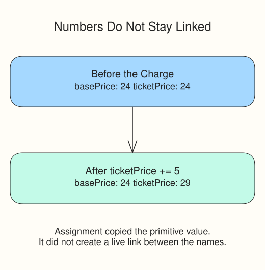

# Adjust a Ticket Price

The preceding tally demo held the award constant while updating a running balance. The ticket desk needs the same distinction: keep `basePrice` fixed at 24, then update `ticketPrice` with a 5-unit facility charge and a 3-unit credit. The final ticket price should be 26.

For a different budget, the update pattern looks like this:

```javascript
const grant = 50;
let balance = grant;
balance += 8;
balance -= 6;
console.log(balance); // 52
```

The starter copies the number in `basePrice` into `ticketPrice`. It does not create a permanent link between them: updating `ticketPrice` leaves `basePrice` at 24. Keep the charge and credit values supplied above the update comments.

Run after the charge to see `charged: 29`. Then add the credit update below that probe, so the first line still records the price before the credit. Your final two logs compare the unchanged base with the adjusted price.

Edit `script.js`, Run to inspect each checkpoint, then Submit to check the completed tasks. The supplied probes do not need rewriting.



## Your Tasks

1. Increase `ticketPrice` by `facilityCharge` with `+=`; the provided probe will log `charged: 29`.
2. Decrease `ticketPrice` by `credit` with `-=`; the provided probe will log `credited: 26`.
3. Log the unchanged `basePrice` as `base: 24`.
4. Log the adjusted `ticketPrice` as `ticket: 26`.

## Variables and operators complete

You can convert external price text, group charges correctly, and update a price without losing its fixed base. Take the section quiz before moving on to decisions.
