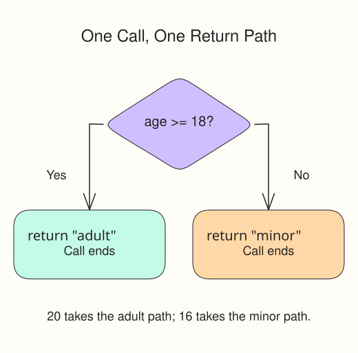

This section teaches a script to choose between outcomes. Keep the work in `script.js` and check results in the Console.

Conditional statements let your program make decisions. `score >= 90` asks whether a number is at least 90 and yields `true` or `false`. In an `if / else if / else` chain, JavaScript checks conditions from top to bottom and runs only the first matching branch. Put the highest threshold first so 95 does not get classified by a lower one.

## Syntax

```javascript
if (condition) {
    // runs when condition is true
} else if (anotherCondition) {
    // runs when first was false but this is true
} else {
    // runs when none of the above matched
}
```

## A named calculation

You just wrote a small function in the primer. Read `function name(input) { ... }` as a reusable calculation: the input takes a different value on each call, and `return` sends back its result. This separate example uses a different rule:

```javascript run
function accessLevel(age) {
  if (age >= 18) return "adult";
  return "minor";
}
console.log(accessLevel(20));
```

Use the supplied function shape to classify scores. This version returns from each matching branch, so it can use consecutive `if` statements without `else if`.

The starter supplies the function and its calls. `undefined` means the fallback has no finished result yet; keep it until the last task so unfinished grades can still be printed safely. Change only the indicated branch or fallback at each step.

A `return` ends the current function call immediately. Because every matching branch returns, these consecutive `if` statements behave like an `if / else if` chain: a score that earns A never reaches the B check. Keep them in descending order. The `>=` includes the cutoff itself; `>` would incorrectly exclude 90, 80, 70, or 60.

| After completing | New completed Console line |
|---|---|
| A branch | `A range: A,A` |
| B branch | `B range: B,B` |
| C branch | `C range: C,C` |
| D branch | `D range: D,D` |
| F fallback | `F range: F,F` |

Each earlier line should stay correct as you add the next branch. The probes include both ends of each range, not just a score in its middle.

Edit `script.js`, Run to inspect the supplied probes, and Submit to check the tasks.



## Your Tasks

1. Add the A branch for scores at least 90. The `A range` probe should show `A,A`.
2. Add the B branch after A for scores at least 80. The `B range` probe should show `B,B`.
3. Add the C branch after B for scores at least 70. The `C range` probe should show `C,C`.
4. Add the D branch after C for scores at least 60. The `D range` probe should show `D,D`.
5. Replace the fallback with a return of `"F"` for all remaining scores. The `F range` probe should show `F,F`.
